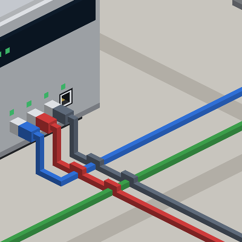

# Cables: choosing the port, attaching to the port, cable on the ground

Written on 2026-11-20. Status: **approved by Max on 2026-11-20**; nothing is coded yet. The decisions are recorded in the "Decisions taken" table of `docs/lot-plan.md`:

- choice of the port by aiming, with aim zones that go on over the top face of flat devices;
- plugs drawn by the client from the cables it knows (check in the 26.3 sources how to draw a small model in the cable pass before coding);
- cable on the ground drawn, not placed in the world;
- a wall is gone around, otherwise the cable hangs in the air until the wall sockets;
- lot 1d renamed 1d-1; lot 1d-2 in version 0.2.0;
- the tower and the laptop redrawn on the design guide, with the position of their ports, before lot 1d-1.

Visual design of the cables, chosen by Max on 2026-11-20 from the previews of `design/tools/cables.py` (drafts under `design/blockbench/drafts/`): one RJ45 size on every device (2 x 2 texels), the plug with its long boot, the two-tone outline of the aimed port, the eight cord colours of `design/palette.json` (key `cords`), the cord icon with the taller plug, the overhang of the plug behind the tower and the laptop accepted (section 4). Proposed the same day, not decided yet: the lane step of 0.5 px (section 5) and the cords as items (colour, type, length, section 7).

## 1. Steps

Each step is playable on its own. Only steps 1 and 2 are designed in detail here; section 6 checks that their architecture carries steps 3 and 4.

| Step | Lot | Playable at the end |
|---|---|---|
| 1 | 1d-1 | The player aims at the port they want: it is outlined and the status panel names it before the click. The cable leaves from the port itself, with an RJ45 plug pushed into it |
| 2 | 1d-2 (new lot, right after 1d-1, version 0.2.0) | The cable has a thickness, comes down from the plug, lies on the floor following the terrain and goes up to the other device; the player walks over it |
| 3 | 2b | RJ45 wall sockets; a cable fixed along the wall |
| 4 | 2b, then 8a | Trunking along the walls (2b), then cable trays (8a) |

## 2. What exists today (code read on 2026-11-20)

- `EthernetCableItem`: the first click takes `NetworkManager.firstFreePort`, the second click too; unplugging (sneak + cord) and taking an end off (sneak + empty hand, `takeCableEnd`) take the first occupied port (`disconnectFirst`). `CableStart` already keeps the index of the start port.
- The click reaches the server with the point aimed at: `UseOnContext.getClickLocation()` and `getClickedFace()` (checked in the 26.3 sources). Resolving the aimed port on the server needs no new packet. With an empty hand, `NetworkDeviceBlock.useWithoutItem` already has the `BlockHitResult` and only has to pass it on to `takeCableEnd`.
- The client already knows the position and the port of both ends of each cable it receives (`ClientLink`): attaching the cable to its port, and naming the port at the other end in the panel, need no packet change. The name of the device at the other end is known only if its chunk is loaded on the client.
- `CableRenderer`: a line (`RenderTypes.lines`) of 16 segments along a parabola, attached at the centre of the block at a fixed height of 0.3 block (`ATTACH_HEIGHT`) for every device; a held cable goes from the device to the hand.
- `PortStatusLayer` reads `Minecraft.hitResult` and draws the lines built in plain Java by `StatusPanel`.

## 3. Step 1a: choosing the port

### Options

| | Aim at the port (Max's idea) | Menu | Scroll wheel or sneak to cycle |
|---|---|---|---|
| Gesture | The same two clicks as today | A screen opens at each click: 4 clicks instead of 2 | Scroll (or sneak + click) to pick a number, then click |
| Discovery | Natural: you click where the port is; outline and panel confirm | Explicit list of the ports and their state | Hidden: nothing says that scrolling chooses a port |
| Small ports (every RJ45: 0.5 px) | Needs a tolerance (below) | Not a problem | Not a problem |
| Big switches later (24 or 48 ports, lot 8b) | May become too fine at rack scale | Scales well | Long to cycle |
| Conflicts | None: the cord in hand goes through `onItemUseFirst` before the block | Screen opening in the middle of a gesture | The wheel changes the hotbar slot; sneak is already "unplug" |
| Code | Port layout per device, outline, one panel line | A screen, a packet for the choice | Client input event, a packet or an item component |

**Recommendation: aim at the port, with aim zones.** Elsewhere on the device, the first free port (first occupied port to unplug), as today. The menu stays an idea for the dense switches of lot 8b, not designed now.

### Port layout

One plain Java description per device, `PortLayout`, for a front facing north and turned by `FACING`: for each port, the face that carries it, its **aim zone**, its **hole**, its **mouth** (point and outward direction, where the plug goes in) and its **connector** (RJ45 in lot 1d-1, a single size of 2 x 2 texels on every device; other connectors later, section 4). It is the single source of truth for the server (which port was clicked) and for the client (outline, panel, attachment, plug). Its values come from the device sheets (`design/blockbench/<id>.md`); a unit test checks them: as many ports as the block's `PORTS`, zones inside the shape and disjoint, each hole inside its zone.

### Aim zones (tolerance)

On the face that carries the ports, each port owns the strip of the face up to halfway to its neighbours (the ports at the ends go to the edge of the face), over a band around the ports. **On a flat device, the strip goes on over the top face**, where the port LEDs already are: a player standing 1.5 blocks from a switch on the floor looks down at about 47 degrees and sees its top (3 px deep) about 3 times taller than its front (1 px high); with zones on the front only, most clicks would fall back to the first free port.

Box front on the left (zones over the lower band of the front). Switch on the right: its top as seen from the front (LEDs along the front edge), then its front; each port's zone runs over both. Holes in black, one tint per zone.

| Device | Hole | Aim zone | Gain |
|---|---|---|---|
| Internet box (4 LAN) | 0.5 x 0.5 px | about 1 px wide (2.5 px at the ends) x 2.5 px high (y 0.75 to 3.25) | x 10 or more |
| 5-port switch | 0.5 x 0.5 px | 0.75 px wide (0.875 px at the ends) x the whole front (1 px) and the whole depth of the top (3 px) | x 12 |

The click point is turned into the north frame of the device, then looked up in the zones of the clicked face. It lies on the Java shape of the block, not on the model: on the box, the shape's front is the glass band plane, 0.25 px in front of the port panel. The zones are wide enough for this gap not to matter. A click on another face, or outside the zones: no port is aimed, fallback to the first free port. A device with a single port (tower, laptop) needs no zone, but gets the outline so that the player sees where the cable goes.

**Port positions.** Every device now has the position of its ports in its sheet, with a paragraph "For lot 1d-1": the box, the tower and the laptop since their rework on 2026-11-20 (ports of 2 x 2 texels), the 5-port switch in its approved draft.

### Feedback before the click

- Outline of the aimed port: a **two-tone frame** around the hole, a light line of 1/16 px against the hole and a dark one outside it, drawn without shading by the client like the block outline, only with a cord in hand or when sneaking with an empty hand (chosen by Max on 2026-11-20: a single light line disappears on the light devices, a dark one on the dark devices). Not a status colour: the status panel shows a free port with a grey light and a connected port with a green one, so a green frame for "free" would contradict it.
- Status panel, an added line: compact "Port 3: free" or "Port 3: connected"; detailed (sneaking) also the device at the other end and its port. New language keys in both files, sample values in `LangFilesTest` (45 characters for the panel).
- Click on an occupied aimed port: refusal "Internet Box, port 3: already in use." (new key), instead of "no free port".

### Gestures (all of them follow the aimed port)

| Gesture | Aimed port | Elsewhere on the device |
|---|---|---|
| First click, cord in hand | Starts from this port | First free port |
| Second click | Ends on this port | First free port |
| Sneak + click, cord in hand (unplug) | Unplugs this port | First occupied port |
| Sneak + click, empty hand (take an end off) | Takes off this end | First occupied port |

## 4. Step 1b: the cable attached to its port, with its plug

- **Attachment:** the end of the cable is the mouth of its port (`PortLayout`, turned by `FACING`, read from the block state on the client). `ATTACH_HEIGHT` disappears. The cable leaves along the outward direction of the port over the length of the plug.
- **Plug:** one model for every device, as a real RJ45 has a single size (Max, 2026-11-20): drawn like the devices (`design/blockbench/rj45_plug_<colour>.bbmodel`, sheet `rj45_plug.md`, by `design/tools/rj45_plug.py`; chosen by Max on 2026-11-20). One texture `rj45_plug.png` for the eight cord colours and one model per colour where only the UV of the boot changes; the client picks the model from the colour of the link. Its clear body fills the hole of 2 x 2 texels: 0.5 px inside, 0.5 px out, highlight tone of light plastic; then the **long boot**, 0.75 px, as wide as the body, in the colour of the cord (cords are a colour family of their own, guide section 4); then the cable. The plug and the bend of the cable take about 1.5 px out of the mouth.
- **Plug assets, exported on 2026-11-20** by `design/tools/export.py rj45_plug_<colour>` (eight projects, one texture):
  - models `assets/worldwideblocks/models/block/rj45_plug_<colour>.json`, that is `worldwideblocks:block/rj45_plug_<colour>`, where `<colour>` is a key of `cords` in `design/palette.json`: `blue`, `grey`, `yellow`, `green`, `red`, `orange`, `black`, `white`. The eight models differ only by the UV of the boot;
  - one texture `assets/worldwideblocks/textures/block/rj45_plug.png` (`worldwideblocks:block/rj45_plug`, 32 x 32), in `textures/block/`, which the block atlas loads by itself (`assets/minecraft/atlases/blocks.json` of 26.3, directory `block`): no atlas file to write;
  - the model is a plug in a port facing north, its mouth at 8, 8, 8 (sheet `design/blockbench/rj45_plug.md`): the client turns it with the port (0 north, 90 east, 180 south, 270 west, as the `y` of a blockstate) and moves its mouth to the mouth of the port given by `PortLayout`;
  - **loading at lot 1d-1:** no block state uses these models, so the game does not bake them by itself. The client registers them as standalone models: `ModelEvent.RegisterStandalone`, one `StandaloneModelKey` per colour, `SimpleUnbakedStandaloneModel.quadCollection(id)` (classes read in the sources of NeoForge 26.3.0.103; their use is to confirm at lot 1d-1, first box of issue 1d/07), then picks the model from the colour of the link.
- **Overhang accepted** (Max, 2026-11-20, realistic): the mouth of the tower is 0.5 px from the edge of its block and that of the laptop 1 px, so their plug goes out of the block; a tower or a laptop against a wall has its plug drawn inside the wall, as a real plug stands out behind a computer pushed against a wall.
- **Thick cable:** square section of 0.25 px (a 6 mm cord x 2.4 is 0.23 px), four faces per segment, lit by the light of the world where it passes, in the colour of the cord. It replaces the line of `RenderTypes.lines`. The held cable goes from the plug to the hand.
- **In step 1 the cable keeps today's hanging curve**, between the ends of the two plugs. Step 2 replaces this curve.
- Preview of the chosen plug (`design/tools/rj45_plug.py` and `preview.py`, not the game's rendering), turned with each port as the client will: internet box LAN 1 to 4, 5-port switch, 8-port switch, laptop (left flank), tower (back), each with a cable stub to the floor, the colours in the order of the palette.

### How to draw the plugs

| | From the cables known to the client (recommended) | Block states per port with multipart models |
|---|---|---|
| Source | `ClientLinkCache`, the same as the cables | A copy of "port connected" in each block state |
| Consistency | Always the same as the drawn cable | A second copy of the state of the links, stale in a chunk that is not loaded when the other end is unplugged |
| Cost | Drawn each frame with the cables | Baked with the chunk, but 2^ports x 4 block states and a chunk rebuild at each change |

**Recommendation: from the cables known to the client.** To check in the 26.3 sources before coding: how to submit a small baked model or textured quads in `SubmitCustomGeometryEvent`.

### Other connectors (proposal, 2026-11-20)

The RJ45 hole is already the smallest the grid of texels allows (2 x 2 texels), so a future connector is never told apart by a smaller hole: **by the shape of its plug and the thickness of its cable**, never by its colour (section 7). Each type is its own item (section 7) and its own port kind in `PortLayout`.

| Cable | Lot | Plug | Cable section |
|---|---|---|---|
| Copper, RJ45 | 1d-1 | Clear body of 2 x 2 texels, long boot in the colour of the cord | Square, 0.25 px |
| Telephone, RJ11 | 3b | Clear body of 2 x 2 texels, short (0.25 px out), no boot | Flat, 0.25 x 0.125 px (a real telephone cord is flat) |
| Fibre, duplex LC | 3a | Two square bodies of 2 x 2 texels side by side, joined by a clip on top, a long boot | Two strands of 0.125 px side by side (a duplex cord) |
| Power cord | 1e | A wide body (C13 at the device side, 0.75 x 0.5 px), dark plastic, no clear part | Round-looking square, 0.375 px, the thickest |
| Console cable | 8b | An RJ45 at the switch end, a wide plug (serial or USB) at the computer end | Flat, 0.25 x 0.125 px |

Telephone and console cables share the flat section and are told apart by their plugs, which also never fit the same ports. Sizes of 0.125 px are off the texel grid: the cable is drawn by the code, not textured, so this does not matter.

## 5. Step 2: the cable on the ground (sub-lot 1d-2)

### Drawn, or placed in the world?

| Consequence | Drawn (route computed by each client) | Placed in the world (cable blocks, like redstone) |
|---|---|---|
| Walking over it | Yes, nothing to collide with | Yes, with an empty collision shape; but each cell it crosses is taken: no carpet, torch or flower there, and no other block |
| Walls | The route goes around (doors) or, failing that, hangs in the air; the player does not choose it | The player lays the route by hand, through an opening; realistic, but long |
| Wall sockets, trunking, trays (steps 3 and 4) | Real blocks that become fixed points of the route (section 6): the player controls the route where it matters | Natural: everything is blocks |
| Save | Nothing: the route is derived from the terrain. Later, the fixed points in the link (an optional field, old worlds still load) | Blocks or block entities in every chunk crossed, plus the link in the engine: two copies to keep in agreement, also when a cable is cut in a chunk that is not loaded |
| Multiplayer | No cost on the server; each client computes the routes it sees; the same blocks give the same route | Block updates for each cell, cables that can be cut by another player, more data per chunk |
| Length of a cable | Straight distance (100 blocks), as today, until there are fixed points: the drawn cable can be longer than the length used for the 100-block limit and for the latency shown by `ping` | Real length of the route |
| The route changes | When a block changes on it: a block placed on the cable makes it move aside; doors count as always passable, so that opening and closing one does not move the cable | Only when the player moves it |
| Code | A route computed on the client from the terrain, cached | Cable blocks, placement and cutting, agreement between the engine and the world |

**Recommendation: drawn.** It follows the rule "the server decides, the client displays", keeps a single copy of the network (the engine), adds nothing to the save, costs nothing on the server, and the player walks over it. The control that a world cable would give comes with steps 3 and 4, through real carrier blocks (sockets, clips, trunking, trays).

### The route

A route is a chain: **port A, span, fixed points (none in step 2), span, port B.** Step 2 has two kinds of span:

- **On the ground:** out of the plug, down to the surface below (the top of the first collision shape under it), then along the floor to below the other plug, then up into it. Along the floor, a path search on the cells of a corridor around the straight line (8 blocks on each side): it goes around walls (through a door), climbs up to one block (steps, slabs), may come down a drop. The path is then straightened where nothing is in the way, and laid on the real height of the surfaces, sampled every quarter of a block.
- **Hanging:** today's curve, between two points. Used when no route is found on the ground (wall without an opening, closed room, a part of the terrain not received by this client). Step 3 (wall sockets) gives the clean answer to a wall.

Rules:

- **Several cables in the same place:** each cable is shifted sideways by a fixed amount taken from its identifier, and laid a quarter of a pixel higher where it crosses another, so that two cables never fight for the same pixels. **Proposed step: 0.5 px** (2026-11-20, preview `cable_lanes`), a gap of one cable width between two neighbours: at 0.25 px they touch and read as one flat cable; 0.75 px is also possible, at the cost of wider bundles. Through a turn, the outer cable turns further out and the inner one earlier, so the step holds. Cables of the same device fan out from their ports anyway.
- **Recomputed only when needed:** the client keeps the route of each visible cable and recomputes it when a block changes in its corridor or when a chunk it crosses arrives, with a budget per frame so that a large change does not freeze the game.
- **Performance:** nothing on the server; on the client, a search over at most a few thousand cells per cable, once per change, and a mesh rebuilt only when the route changes. Hundreds of cables (lot 8a) will need the meshes baked once; to look at then.
- **Testable:** the route is computed in plain Java from a terrain interface (height of the surface, can a cable pass), with fake terrains in `src/test`.

### What stays for lot F

The polish: rounded bends, a little slack, the cable lights of the ports (idea "Port lights in the finishing lot").

## 6. Steps 3 and 4: does the architecture hold?

- **Wall socket (2b):** a passive device with ports: it gets a `PortLayout`, the aim, the plugs and the attachment of steps 1 and 2 without change. The cord from the computer to the socket is an ordinary cable.
- **Cable fixed to the wall (2b):** wall clips are fixed points of the route; between two of them, a third kind of span, "along the wall".
- **Trunking (2b) and cable trays (8a):** real blocks placed by the player. The route of a cable is searched on the server through the network of carriers between the entries closest to its two ends, and stored as fixed points in the link (optional field in `NetworkSavedData`). A fourth kind of span, "carried", runs straight inside the carrier. The length of the cable becomes the length of its route.
- Nothing of steps 1 and 2 is thrown away: port layout, plug, thick cable, chain of spans, route cache. Steps 3 and 4 add kinds of span and fixed points.

### Needs of step 3 noted on 2026-11-20 (not designed yet)

1. **Preview before laying a cable through a wall:** the route is shown before the click that confirms it.
2. **Finding hidden cables again** (offices): a view through the walls while holding a cable, each cable in the colour of its cord. Later, a detection tool of lot 9a could show the same.

What steps 1 and 2 must keep possible, and do:

| Need | What it requires | Provided by steps 1 and 2 |
|---|---|---|
| Preview | Computing a route before it exists, on the client, from the pending end (`CableStart`) to the aimed point or port | The route is computed in plain Java from a terrain interface, without the network: the same code computes a candidate route for the preview. It must live in common code, not in `client/`, so that the server can also compute and check routes from step 3 on |
| Route known to the client | The whole route of a hidden cable, including the parts inside walls and carriers | Free spans are computed by the client; fixed points (step 3) are stored in the link and sent with it (`LinkAddedPayload` gains them then): the client knows the whole chain |
| Drawing through blocks | A second drawing of the routes without the depth test, only while the player holds a cable (or the 9a tool) | The thick cable mesh is built once per route and kept: drawing it a second time with a render type that ignores depth costs no new computation. The render type to use is to check in the 26.3 sources at step 3 |
| Colour of the cord | A colour per cable | Today every cord is blue; the colour becomes a property of the link, sent with it, when cords of several colours exist (section 7) |
| Detection tool (9a) | The same view, triggered by an item | Same code as the view through the walls, another trigger |

## 7. Cords as items: colour, type and length (proposals, 2026-11-20)

Proposed by Max on 2026-11-20, to decide before the lot that brings each part (open decisions of `docs/lot-plan.md`). Nothing is coded.

### Colour

- **One item per type of cable; the colour is a property of the item** (a data component), not a separate item. Default: blue.
- **Changed in the crafting table by combining the cord with a dye**, as dyed leather armour. Each of the eight cord colours of `design/palette.json` (key `cords`) has its dye: blue, gray (grey), yellow, green, red, orange, black, white. Proposal: the other dyes are not accepted (a cord colour is one of the eight, never a mix). To check in the 26.3 sources before coding: the dye recipe of the leather armour and its data component, to reuse or to copy.
- **Creative tab:** one entry per colour.
- **Proposal: recolouring a laid cable.** A right-click with a dye on a port with a cable plugged in (the aimed port of section 3) recolours that cable and uses one dye. The colour then becomes a property of the link: kept by the engine and the save (old worlds load with blue), sent to the clients with the link (`LinkAddedPayload`).
- **A cable unplugged gives back an item of its colour.**
- **The tooltip and the status panel show the name of the colour** (language keys in both files), for colour-blind players: **a colour carries no rule of the game**, it only helps the player find a cable.

### Types

- **Each type of cable is a distinct item**: copper RJ45 (today's Ethernet cable), telephone RJ11, fibre, the power cord of lot 1e, the console cable of lot 8b. Recognisable by its plug and its thickness (section 4), never by its colour.
- **Fibres take by default the standard colours of the real cords** (TIA-598-C, from secondary sources, to check against the standard before coding): yellow for single-mode (OS1, OS2); orange for multimode OM1 (OM2 is orange or grey depending on the source); aqua for OM3 and OM4 (some makers use violet for OM4); lime green for OM5. Aqua and lime would join the `cords` family of `design/palette.json` with the fibres.

### Length (to think about with the decision "Making cables by hand", lot 2b)

The length of a cable must live in the item beside the type and the colour. Proposal: the type stays the item, the colour and the length are two data components; two cords stack only when both are equal (the game compares the components when stacking). Finished cords have a fixed length; a cut cable (if the tools of lot 9a are brought forward to 2b) carries its own, and the link keeps it for the 100-block limit and the latency shown by `ping`.

### Label (idea)

Labelling a cable, as an item renamed at the anvil, with the label shown in the status panel: noted as an idea issue, not designed.

## 8. Impacts on the existing code (steps 1 and 2)

| Part | Change |
|---|---|
| Blocks (`PcTowerBlock`, `LaptopBlock`, `InternetBoxBlock`, then the switches) | Each declares its `PortLayout` |
| `PortLayout` (new, plain Java) | Ports, zones, holes, mouths, rotation by `FACING`; unit tests |
| `EthernetCableItem` | Start, finish, unplug and take an end off use the aimed port, fallback as today; refusal "port in use" |
| `NetworkDeviceBlock` (empty hand) | Passes the click point to `takeCableEnd` |
| `StatusPanel`, `PortStatusLayer` | An optional aimed port, one more line; new keys in `en_us.json` and `fr_fr.json`, samples in `LangFilesTest` |
| `CableRenderer` | Attachment at the mouth of the port, plugs, thick cable; step 2: routes on the ground, cache, hanging fallback |
| Route (new, plain Java, step 2) | Chain of spans, search on the ground, straightening, lanes; tests on fake terrains |
| Packets, engine, save | Unchanged in steps 1 and 2 |
| Device sheets | A "Port layout" table (zone, hole, mouth, direction, size) for each device |
| `design/tools` | Prints the port layout of a device for the Java code; the plug model |
| Capture runs (`docs/automated-checks.md`) | Scenes for the outline and the panel line, plugs, cables on flat and uneven ground, a wall, several cables |

## Sources

Fibre jacket colours (TIA-598-C), read on 2026-11-20, secondary sources:

- [FOA, fibre optic colour codes](https://www.thefoa.org/tech/ColCodes.htm): single-mode yellow, OM1 and OM2 orange, OM3 and OM4 aqua.
- [Leviton, recognising multimode fibre types by colour](https://leviton.com/support/literature/blogs/recognizing-multimode-fiber-types-color): OM2 grey in current practice, early OM2 orange.
- [Wikipedia, TIA-598-C](https://en.wikipedia.org/wiki/TIA-598-C): violet OM4 from some makers.
- [FS.com, fibre colour code guide](https://www.fs.com/blog/fiber-color-code-complete-guide-to-mastering-identification-3751.html): jacket and connector colours, lime for OM5.
